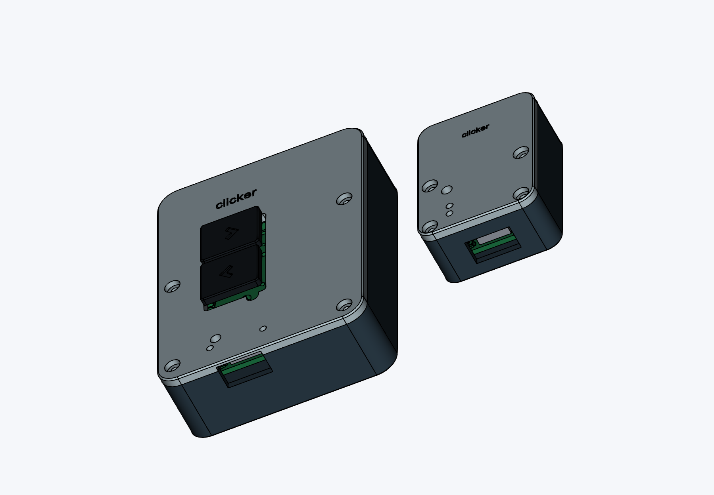

# Clicker

A two-button wireless remote for presentations. I wanted something small that I could use to change slides without staying next to my computer. The buttons default to left and right arrow, but they can be changed to other keys or shortcuts over USB.



## How it works

There are two boards. The battery-powered remote has two Kailh Choc V1 switches and an ESP32-C3. It sends the button states to an ESP32-S3 receiver over ESP-NOW. The receiver plugs into the computer through USB-C and acts as a USB keyboard, so it does not need a separate keyboard driver. The wireless link does not need a router.

Both boards have BOOT and RESET buttons, a programming header, and status LEDs. The remote also has a power switch, a battery connector, and a USB-C charging port. Both PCBs are two-layer boards.

### Remote PCB


### Receiver PCB


## Using it

After flashing and pairing the boards:

1. Plug the receiver into the computer with a USB data cable.
2. Turn on the remote and open the presentation. Click the presentation window so it has keyboard focus.
3. Button 1 sends left arrow for the previous slide. Button 2 sends right arrow for the next slide. Use the remapping commands below if the presentation software expects different keys.
4. Turn off the remote when finished. The current firmware keeps the radio awake while it is on.

Holding a button holds the corresponding keyboard key. If the wireless link stops, the receiver releases the keys after 300 ms to avoid a stuck key.

### First setup

The [firmware guide](firmware/README.md) has the build commands, board settings, upload instructions, and pin assignments. The remote and receiver use different ESP32 targets, so each needs its own sketch.

Once both are flashed, open each board's USB serial console at 115200 baud with newline enabled. Send `status` to get its MAC address. Generate a shared pairing key on the computer:

```sh
python3 -c 'import secrets; print(secrets.token_hex(16))'
```

Send `pair <receiver-MAC> <key>` to the remote, then `pair <remote-MAC> <same-key>` to the receiver. Replace the placeholders with the actual addresses and the generated 32-character key. Pairing is saved through restarts. `unpair` clears it.

### Changing the buttons

Send these commands to the receiver's USB serial console to use page up and page down:

```text
map 1 pageup
map 2 pagedown
status
```

For the original slide controls, use `map 1 left` and `map 2 right`. Changes save immediately and do not need a firmware upload. Letters, other keyboard keys, and modifier combinations are supported too. The [firmware guide](firmware/README.md#remapping) lists the options. Media keys and sequences of multiple key presses are not implemented.

## Parts and assembly

The [full BOM](BOM.csv) covers one remote and one receiver, including the battery, case screws, and PCB orders. It includes supplier links, quantities used, and quantities bought. Some parts come in minimum packs, and each PCB quote is for five boards.

The submitted parts estimate is **$40.78**, plus a **$23.54 provisional shipping and tax allowance**, for **$64.32**. These are the submission quotes, not current checkout prices. Final shipping, taxes, and PCB discounts still need checking before ordering.

### Bill of materials

Quantities used are for one working pair. Order quantities include the supplier packs and spare boards. Prices are in USD.

| Part | Used | Order | Unit price | Total | Supplier |
| --- | ---: | --- | ---: | ---: | --- |
| ESP32-S3-WROOM-1-N4 | 1 | 1 each | $4.15 | $4.15 | [LCSC](https://www.lcsc.com/product-detail/C2913197.html) |
| ESP32-C3-WROOM-02-N4 | 1 | 1 each | $3.32 | $3.32 | [LCSC](https://www.lcsc.com/product-detail/C2934560.html) |
| AP2112K-3.3TRG1 (5 pack) | 2 | 1 pack of 5 | $0.86 | $0.86 | [LCSC](https://www.lcsc.com/product-detail/C51118.html) |
| TYPE-C-31-M-12 (5 pack) | 2 | 1 pack of 5 | $0.86 | $0.86 | [LCSC](https://www.lcsc.com/product-detail/C165948.html) |
| Microchip MCP73831T-2ATI/OT | 1 | 2 each | $1.40 | $2.80 | [LCSC](https://www.lcsc.com/product-detail/C14879.html) |
| Omron B3U-1000P (5 pack) | 4 | 2 pack of 5 | $0.94 | $1.88 | [LCSC](https://www.lcsc.com/product-detail/C231329.html) |
| JST B2B-PH-K-S(LF)(SN) (20 pack) | 1 | 1 pack of 20 | $0.71 | $0.71 | [LCSC](https://www.lcsc.com/product-detail/C131337.html) |
| Kailh Choc V1 red switches | 2 | 2 each | $0.60 | $1.20 | [Keebio](https://keeb.io/products/kailh-choc-low-profile-switches-v1?variant=40343498227806) |
| 0603WAF1001T5E (100 pack) | 3 | 1 pack of 100 | $0.26 | $0.26 | [LCSC](https://www.lcsc.com/product-detail/C21190.html) |
| Yageo RC0603FR-0710KL (100 pack) | 2 | 1 pack of 100 | $0.34 | $0.34 | [LCSC](https://www.lcsc.com/product-detail/C98220.html) |
| 0603WAF1003T5E (100 pack) | 2 | 1 pack of 100 | $0.31 | $0.31 | [LCSC](https://www.lcsc.com/product-detail/C25803.html) |
| 0603WAF2001T5E (100 pack) | 1 | 1 pack of 100 | $0.24 | $0.24 | [LCSC](https://www.lcsc.com/product-detail/C22975.html) |
| Yageo CC0603KRX7R9BB104 (50 pack) | 2 | 1 pack of 50 | $0.62 | $0.62 | [LCSC](https://www.lcsc.com/product-detail/C14663.html) |
| CL10A106MQ8NNNC (10 pack) | 2 | 1 pack of 10 | $0.23 | $0.23 | [LCSC](https://www.lcsc.com/product-detail/C1691.html) |
| CL10B105KO8NNNC (50 pack) | 2 | 1 pack of 50 | $1.06 | $1.06 | [LCSC](https://www.lcsc.com/product-detail/C59782.html) |
| M2 x 6 mm stainless steel screws (25 pack) | 8 | 1 pack of 25 | $3.49 | $3.49 | [Keebio](https://keeb.io/products/m2-screws-and-standoffs?variant=47874887558) |
| SS14 Schottky diodes (50 pack) | 2 | 1 pack of 50 | $0.94 | $0.94 | [LCSC](https://www.lcsc.com/product-detail/C2480.html) |
| Kingbright APT1608SURCK red LEDs (5 pack) | 3 | 1 pack of 5 | $0.63 | $0.63 | [LCSC](https://www.lcsc.com/product-detail/C5875723.html) |
| C&K OS102011MS2QN1 power switch | 1 | 1 each | $0.66 | $0.66 | [LCSC](https://www.lcsc.com/product-detail/C221829.html) |
| 1x3 2.54 mm pin headers (5 pack) | 2 | 1 pack of 5 | $0.12 | $0.12 | [LCSC](https://www.lcsc.com/product-detail/C32713269.html) |
| Adafruit 1578 protected 3.7 V 500 mAh battery | 1 | 1 each | $7.95 | $7.95 | [Mouser](https://www.mouser.com/en/ProductDetail/Adafruit/1578?qs=GURawfaeGuBBv%2Fo5AsyERQ%3D%3D) |
| Receiver PCB (5 board batch) | 1 | 1 batch of 5 boards | $4.00 | $4.00 | [JLCPCB](https://cart.jlcpcb.com/quote) |
| Remote PCB (5 board batch) | 1 | 1 batch of 5 boards | $4.00 | $4.00 | [JLCPCB](https://cart.jlcpcb.com/quote) |
| 0603WAF5101T5E (100 pack) | 4 | 1 pack of 100 | $0.15 | $0.15 | [LCSC](https://www.lcsc.com/product-detail/C23186.html) |
| Printed case parts | 4 | 4 printed part | $0.00 | $0.00 | [Already owned filament](enclosures/stl) |
| Printed keycaps | 2 | 2 printed part | $0.00 | $0.00 | [Already owned filament](enclosures/stl) |
| Tax and shipping allowance |  | 1 allowance | $23.54 | $23.54 | [Multiple suppliers](https://halflife.hackclub.com/projects/cmuo5o3bs001h01q34f93breu) |
| **Total estimate** | | | | **$64.32** | |

### Assembly

The board-level component lists are [remote BOM](remote/production/bom.csv) and [receiver BOM](receiver/production/bom.csv). The full BOM records the supplier substitutions selected during sourcing, including the LEDs and power switch that still need checking before purchase.

Solder the small surface-mount parts first, then the modules and connectors. Check orientation and inspect for bridges before powering either board. Bring up the boards on current-limited USB power and check the 3.3 V rails before flashing them.

The remote currently has a 2k charge-program resistor, which sets roughly 500 mA. Check this against the selected battery's charging limit and change the resistor if needed before connecting the battery. Also check the battery connector polarity. Charging, battery runtime, and operation as the battery discharges still need testing.

## Cases

Both boards sit on printed supports and are held down by the lids. Each case uses four M2 x 6 mm screws. The remote's battery sits beside the PCB to keep the case thinner.

The switch centres are 16.5 mm apart, so I made narrower printed keycaps with a 1.1 mm gap. Print the stem-fit sample before the keycaps and check that they seat without forcing the switch sockets.

- [Print plate](enclosures/clicker-print-plate.3mf)
- [Individual STL files](enclosures/stl)
- [Case download with STEP models and assembly instructions](enclosures/clicker-enclosures.zip)

Use PLA or PETG, around 0.16 to 0.20 mm layers, and at least three walls. Select the printer and material in the slicer. Check the USB openings, screw holes, and keycap stems in the slice preview before printing.

## Design files and progress

The editable KiCad projects are in [remote](remote) and [receiver](receiver). Ready-to-upload Gerber ZIPs are in [remote/production](remote/production/gerbers.zip) and [receiver/production](receiver/production/gerbers.zip). The [journal](journal.md) has the design progress.

The boards are routed, the firmware has compiled, and the cases have been checked in CAD. Nothing has been assembled or physically tested yet. The next step is to check the remaining part choices, build a pair, and test charging, button response, wireless range, and case fit.

Designed by EVV

*Made for Hack Club Half Life*
